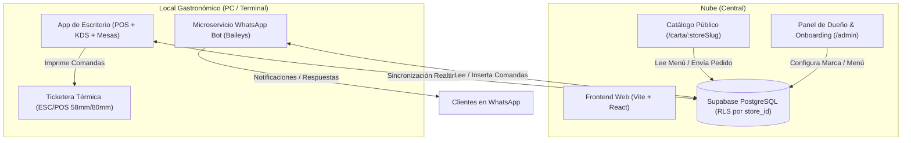

# Especificación de Diseño: Plataforma Gastronómica White-Label Multi-Tenant (ComandaFast)

- **Fecha:** 2026-10-14
- **Estado:** Propuesto para revisión
- **Proyecto:** ComandaFast (Conversión a White-Label SaaS)

---

## 1. Intención y Propósito ("The Why")

Transformar el sistema ComandaFast (actualmente con marca y textos acoplados rígidamente a "ComandaFastBurga") en una **plataforma gastronómica White-Label multi-tenant lista para comercializar**.

El objetivo de negocio es ofrecer a restaurantes, pizzerías, rotiserías, casas de empanadas y hamburgueserías de la ciudad una solución llave en mano que les permita:
1. Gestionar comandas de salón, mostrador y delivery a máxima velocidad.
2. Contar con un catálogo web interactivo con su propia marca (logo, colores, banner).
3. Atender y recibir pedidos automáticos por WhatsApp mediante un bot local que no dependa de servidores externos ni exponga sus números a bloqueos masivos.
4. Administrar mesas en vivo desde una pantalla táctil o tablet.

---

## 2. Metas, No-Metas y Anti-Metas

### Metas (Goals)
- **Aislamiento Multi-Tenant**: Esquema de base de datos en Supabase con Row Level Security (RLS) basado en `store_id`.
- **White-Labeling Completo**: Personalización dinámica de nombre comercial, logotipo, banner, paleta de colores (variables CSS), tipografía, datos de contacto (WhatsApp, Instagram, dirección) y horarios comerciales.
- **Catálogo Digital por Comercio**: URLs amigables públicas (`tudominio.com/carta/:storeSlug`) donde el cliente ve exclusivamente la carta y la identidad visual del negocio correspondiente.
- **Wizard de Onboarding Inicial**: Flujo paso a paso para dar de alta un comercio en menos de 5 minutos (datos de marca, configuración de delivery y métodos de pago, carga inicial de categorías/productos).
- **Módulo de Salón & Mesas**: Mapa interactivo visual con estados en tiempo real (Libre, Ocupada, Cuenta solicitada, Cerrada).
- **Microservicio Bot de WhatsApp Local**: Bot basado en Baileys empaquetado para ejecutarse en la computadora del negocio, vinculando su número con código QR local y sincronizando pedidos en tiempo real con Supabase.
- **Empaquetado de Escritorio para el Comercio**: Aplicación instalable para la PC del local que agrupe en una sola ventana el POS/KDS y el bot local con acceso directo a impresoras térmicas.

### No-Metas (Non-Goals - Fase 1)
- Facturación electrónica fiscal (AFIP u homólogos); se mantiene el ticket de comanda/control interno de alta velocidad.
- Pasarela de pagos con split de comisiones automático (cada local ingresa su propio Alias, CBU o Link de Mercado Pago directo).
- Módulo de delivery con geolocalización por GPS en tiempo real de repartidores (se mantiene el cálculo por zonas/fijo configurables).

### Anti-Metas (Lo que NO debe suceder)
- **Cero servidores centralizados para WhatsApp**: Nunca alojar múltiples sesiones de WhatsApp en una sola IP de datacenter en la nube (evita baneos masivos de Meta y altos consumos de memoria).
- **Cero dependencia crítica de internet**: Si se corta la conexión, la app de escritorio debe permitir seguir cobrando y despachando comandas localmente con sincronización diferida al reconectar.
- **Cero código hardcodeado**: Ningún archivo fuente de la UI debe contener nombres fijos ni textos atados a una marca o tipo de comida en particular.

---

## 3. Arquitectura del Sistema

---

## 4. Componentes y Módulos a Desarrollar / Refactorizar

### 4.1. Esquema de Datos Multi-Tenant (Supabase)
1. **`stores`**:
   - `id` (UUID, PK)
   - `slug` (VARCHAR, UNIQUE) - ej: `pizzeria-roma`
   - `name` (VARCHAR)
   - `logo_url`, `banner_url`, `favicon_url` (TEXT)
   - `theme` (JSONB) - `{ primaryColor, accentColor, bgDark, fontHeading }`
   - `contact_info` (JSONB) - `{ phone, whatsapp, instagram, address, googleMapsUrl }`
   - `business_hours` (JSONB) - horarios por día y estado abierto/cerrado
   - `delivery_zones` (JSONB) - zonas y tarifas de delivery
   - `payment_methods` (JSONB) - efectivo, alias/CBU transferencia, link MP
   - `created_at` (TIMESTAMP)

2. **Tablas con FK `store_id` y RLS**:
   - `products`, `categories`, `orders`, `order_items`, `cash_shifts`, `restaurant_tables`, `bot_settings`.

### 4.2. Motor de Identidad Visual Dinámica (`ThemeContext` / CSS Variables)
- Reemplazar los colores duros (`#f59e0b`, `#0b0f19`) por variables CSS inyectadas en tiempo de ejecución:
  - `--brand-primary`
  - `--brand-accent`
  - `--brand-bg`
  - `--brand-surface`
- Selector dinámico de tipografía y logo en el Header y tickets térmicos.

### 4.3. Onboarding Wizard (`/onboarding`)
- **Paso 1: Identidad del Negocio**: Nombre, rubro gastronómico, slug web, subida de logotipo y selección de colores.
- **Paso 2: Operaciones & Envíos**: Modalidades activas (Mostrador, Salón con mesas, Delivery), costos de envío y horarios de atención.
- **Paso 3: Cobros & Alias**: Métodos de pago permitidos, Alias de transferencia bancaria / MP.
- **Paso 4: Menú Rápido**: Carga guiada de las primeras 3 categorías y 5 productos (con opción de importar plantilla predeterminada según rubro: Pizzería, Hamburguesería, Rotisería).
- **Paso 5: Descarga y Activación del Bot**: Generación del paquete local preconfigurado con el `store_id` del local.

### 4.4. Módulo de Salón & Mesas (`/mesas`)
- Grilla / Mapa de mesas táctil.
- Estados de mesa:
  - 🟢 **Libre**
  - 🟡 **Ocupada (con comanda activa)**
  - 🟣 **Pidiendo la cuenta**
  - 🔴 **Comanda demorada**
- Operaciones rápidas: Abrir mesa, asignar mozo, sumar ítems a la cuenta abierta, emitir precuenta y cerrar mesa liberándola.

### 4.5. Catálogo Digital por Negocio (`/carta/:storeSlug`)
- Detección automática del comercio mediante la URL.
- Encabezado con logo y banner del negocio.
- Carrito de autoservicio optimizado para enviar el pedido formateado directo al WhatsApp del negocio o sincronizarlo con Supabase.

### 4.6. Aplicación de Escritorio & Bot Local
- Configuración de empaquetado para Windows (utilizando Electron o runner local empaquetado).
- Servicio `whatsappBotServer.js` refactorizado para recibir dinámicamente `store_id` y credenciales por archivo de configuración local o argumento CLI, aislándolo de datos estáticos en código.

---

## 5. Decisiones del Constructor (Builder Calls)

1. **Compatibilidad con datos existentes**: Los datos actuales de hamburguesería (`data/products.json`, templates) se mantendrán como la "Plantilla Demo Hamburguesería" utilizable en el wizard de onboarding.
2. **Offline-First Storage**: El servicio `storageService.js` mantendrá su capacidad de operar sobre `localStorage` / `IndexedDB`, pero ahora indexado bajo una clave unificada que incluye el `store_id` activo, sincronizándose bidireccionalmente con Supabase cuando haya red.
3. **Impresión Térmica**: Los tickets térmicos reemplazarán las cadenas de texto estáticas por las propiedades del comercio activo (`store.name`, `store.address`, `store.phone`).

---

## 6. Próximos Pasos (Workflow Superpowers)
1. **Aprobación del Documento de Diseño** (Hard-Gate).
2. **Generación del Plan de Implementación** detallado (`superpowers:writing-plans`).
3. **Ejecución guiada por fases**:
   - Fase 1: Limpieza de hardcoding & Motor de Temas White-Label.
   - Fase 2: Esquema Supabase Multi-Tenant con RLS y Catálogo por Slug.
   - Fase 3: Wizard de Onboarding & Configuración de Tienda.
   - Fase 4: Módulo de Salón & Mapa de Mesas.
   - Fase 5: Refactorización y Empaquetado del Bot Local / Desktop.
